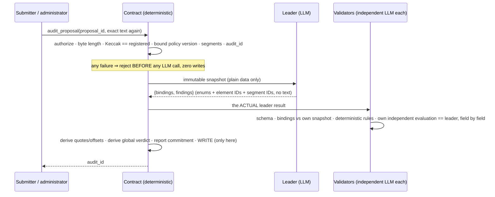

# POLISCOPE

**Evidence-grounded DAO governance proposal auditing as a single GenLayer Intelligent Contract.**

POLISCOPE checks a governance proposal against an **immutable, versioned policy** made of atomic rules, and records an audit that is bound — by Keccak commitments —
to the exact proposal text and the exact policy version that were evaluated. The language model never writes the evidence: it only points at **deterministic
segment IDs**; the contract derives the quotations itself, and every validator must independently reproduce the leader's complete finding list.

> It is an **audit primitive**, not an authority. It does not vote, execute treasury operations, or decide whether a proposal should pass.

## Status — read this first

| | |
|---|---|
| Contract | `contracts/poliscope.py` (single file, legacy GenVM runner `py-genlayer:1jb45aa8…`, header `# v0.2.16`) |
| Local verification | `genvm-lint` ✔ · schema extraction ✔ (9 methods, 0-arg constructor) · **328 direct-mode tests ✔** · mutation testing ****28 / 30 mutants killed** (2 equivalent survivors, documented)** |
| **Deployed / real consensus** | **No.** Nothing has been deployed by the author; real validator consensus, LLM agreement rate and in-GenVM costs are **not measured** |
| Release readiness | **Not release-ready** — see [`docs/SECURITY_AUDIT.md`](docs/SECURITY_AUDIT.md) §4 (blockers) and [`docs/COMPLIANCE_MATRIX.md`](docs/COMPLIANCE_MATRIX.md) (design deviations from the latest directive) |

The first build used the *new* SDK generation and failed to load its schema in the target Studio ("Could not load contract schema"); it is archived under
[`variants/new_generation_UNSUPPORTED/`](variants/new_generation_UNSUPPORTED/) and **must not be deployed**. Details: [`docs/RESEARCH_AND_COMPATIBILITY.md`](docs/RESEARCH_AND_COMPATIBILITY.md) §0b.

## How it works



Key properties (each has tests; see `docs/TEST_MATRIX.md`):

- **Exact commitments.** The proposal text is never stored; its Keccak-256 commitment, byte length and segment count are. One changed byte ⇒ audit rejected before any LLM call.
- **Immutable policy versions**, selected at registration and never silently replaced. New policy = new version (compare-and-set numbering).
- **No LLM-written evidence.** Evidence = segment IDs from a deterministic segmenter; the contract derives exact quotes/offsets from the committed text.
- **Full-result validation.** Validators receive the real leader result and require *exact* agreement on every material field (rule coverage, status, reason code, evidence IDs, missing elements, prohibited hits). No scores, no tolerances, no summary-only checks.
- **Deterministic verdict.** `NON_COMPLIANT` > `INDETERMINATE` > `NOT_APPLICABLE` > `COMPLIANT`, computed by code; an incomplete or malformed report can never be `COMPLIANT`.
- **Exact record identity.** IDs are domain-separated Keccak hashes the client can compute in advance; write methods return their exact ID. No wallet-list diffs, no `latest_*` pointers, no overwrites.
- **Fail closed.** Malformed/oversized model output, leader errors, validator errors, disagreement → no state change.
- **Spanish and English** (and mixed) proposals and policies are supported; text is committed byte-exactly with no normalization.

## Repository layout

```text
contracts/poliscope.py        the Intelligent Contract (the deliverable)
tests/direct/                 328 direct-mode tests (genlayer-test 0.29.2)
tests/ref.py, keccak_ref.py   independent oracle: encoding, segmenter, commitments (never imports the contract)
tools/mutation_test.py        mutation testing (30 injected defects)
docs/                         requirements, architecture, data model, consensus design, threat model,
                              security audit, compliance matrix, test matrix, deployment, known limitations, sources
docs/evidence/                reference implementations + SDK probes used during design
variants/new_generation_UNSUPPORTED/   archived build for a different runner generation — DO NOT DEPLOY
```

## Run the checks

```bash
python3 -m venv .venv && . .venv/bin/activate
pip install -r requirements.txt            # genlayer-test==0.29.2 (NOT 0.30.x) + genvm-linter@main
genvm-lint check contracts/poliscope.py --json     # expect "ok":true, "ctor_params":0
genvm-lint schema contracts/poliscope.py --json    # the reflection the node performs: 9 methods
python -m pytest tests/direct -q                   # expect 328 passed
python tools/mutation_test.py                      # optional, ~10 min
```

If `genlayer-test` cannot download its GenVM bundle (network restrictions), see the note at the bottom of `requirements.txt`.

## Deploying

Read [`docs/DEPLOYMENT.md`](docs/DEPLOYMENT.md). Short version: `genlayer network set studionet`, `genlayer deploy --contract contracts/poliscope.py` (no arguments), then
`genlayer schema <address>` and compare with the 9 methods. The runner in the header **must** match your target Studio; if the Studio reports
*"Could not load contract schema"*, run `genvm-lint schema` on the exact file and compare runner generations before changing anything.
Real-network tests still to perform are listed in `docs/DEPLOYMENT.md` §4 — **none has been run**.

## Known limitations (summary — full list in `docs/KNOWN_LIMITATIONS.md`)

- **Consensus is not truth:** a model bias or prompt injection that moves *all* nodes identically is accepted. Mitigated (fixed prompt, deterministic checks, minimal output space), not eliminated.
- **Liveness is unmeasured:** strict exact agreement across independent LLMs may fail often on ambiguous text; a relaxation is *proposed but not approved* (`docs/CONSENSUS_DESIGN.md` §9).
- **Limits are provisional** (20,000-byte proposals, 12 rules, 400 segments): enforced and tested, but never measured inside GenVM (Keccak-256 is pure Python in the SDK).
- **Rule-level schema** (not element-level) — a deliberate design choice that deviates from the newest directive; see the compliance matrix.
- One audit per proposal; no administrator transfer; permissionless proposal registration without an aggregate cap.
- All LLM answers in the tests are mocks. Direct-mode results are **not** evidence of real multi-validator consensus.

## License

Not chosen yet — add a `LICENSE` file before publishing.
