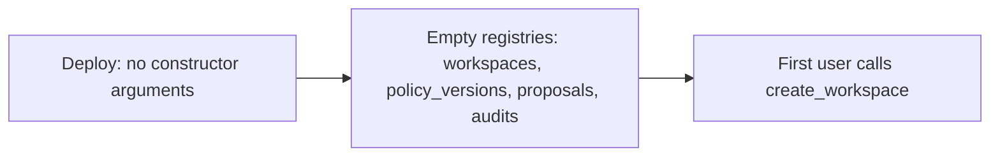
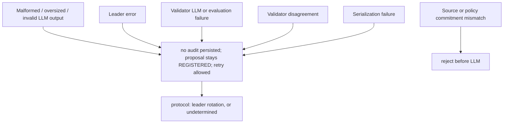
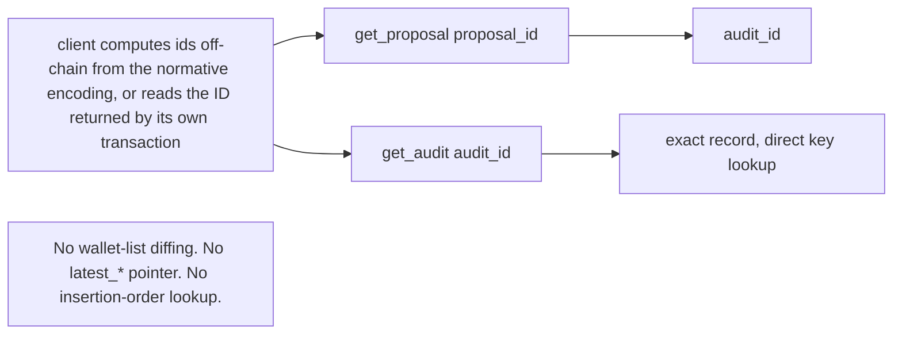

# POLISCOPE — State Machine and Diagrams

Diagrams describe the **implemented** contract (`contracts/poliscope.py`, legacy runner). They render on GitHub (Mermaid).

## 1. States and transitions

```mermaid
stateDiagram-v2
    [*] --> WorkspaceCreated: create_workspace(name, nonce)
    WorkspaceCreated --> PolicyV1: publish_policy(v=1) [administrator]
    PolicyV1 --> PolicyV2: publish_policy(v=2) [administrator, compare-and-set]
    PolicyV2 --> PolicyVn: ... (versions are immutable, never edited)
    [*] --> ProposalRegistered: register_proposal(ws, version, text) [anyone]
    ProposalRegistered --> AuditAccepted: audit_proposal(id, same text) [submitter or administrator] after consensus
    ProposalRegistered --> ProposalRegistered: any failure (rejected, disagreement, undetermined): NO state change
    AuditAccepted --> [*]: terminal (AUDITED; never overwritten)
```



| State | Persisted? | Notes |
|---|---|---|
| Workspace created / Policy version registered / Proposal registered | yes | immutable once written; proposal text is **not** stored, only its commitment |
| Audit in progress | **no** | exists only during transaction execution (no `IN_PROGRESS` record, so nothing can be left half-finished) |
| Audit accepted and recorded | yes | `Proposal.state = AUDITED`, `AuditRecord` written once under its exact `audit_id` |
| Rejected before non-deterministic execution | no | deterministic `[EXPECTED] …` error, zero writes |
| Consensus disagreement / undetermined | no | leader or validators fail closed; protocol behavior on the real network is **UNVERIFIED** (docs only) |
| Semantic `INDETERMINATE` verdict | yes | a **valid completed audit**; distinct from a technical failure |

## A. Deployment and initialization



## B. Workspace and policy lifecycle

```mermaid
sequenceDiagram
    participant A as Administrator
    participant C as Poliscope
    A->>C: create_workspace(name, nonce)
    C-->>A: workspace_id = H(WORKSPACE, creator, nonce)  (sender becomes administrator)
    A->>C: publish_policy(workspace_id, new_version = current+1, rules)
    C->>C: sender == administrator? new_version == current+1? validate every rule, bounds, hostile chars
    C-->>A: policy_set_commitment (version immutable from now on)
    Note over C: no update/delete method exists; a change is a NEW version
```

## C. Proposal registration

```mermaid
flowchart TD
    I[register_proposal: workspace, version, title, nonce, exact text] --> V{validate: types, bytes ≤ limit, hostile code points, non-empty}
    V -- fail --> R1[reject, no write]
    V --> S[segment text: count ≤ 400]
    S -- over limit --> R1
    S --> H[source_commitment = Keccak over exact UTF-8, no normalization]
    H --> ID[proposal_id = H(workspace, version, submitter, commitment, nonce)]
    ID --> X{already exists?}
    X -- yes --> R2[PROPOSAL_EXISTS, no overwrite]
    X -- no --> W[store ID, commitment, byte length, segment count, title, submitter; NOT the text]
```

## D. Audit execution

```mermaid
sequenceDiagram
    participant U as Submitter or administrator
    participant C as Contract (deterministic)
    participant L as Leader (LLM)
    participant V as Validators (each: independent LLM)
    U->>C: audit_proposal(proposal_id, exact text again)
    C->>C: authorize; byte length == stored; Keccak == stored; bound policy version; policy commitment recomputed; segments; audit_id; not already audited
    Note over C: any failure here ⇒ reject BEFORE any LLM call, zero writes
    C->>L: immutable snapshot (plain data only)
    L-->>C: report {bindings, findings} (segment IDs, enums, element IDs; no text)
    C->>V: the ACTUAL leader result
    V->>V: Return? schema? bindings == own snapshot? deterministic rules? own independent evaluation == leader findings, field by field?
    V-->>C: agree only if everything matches
    C->>C: re-validate; derive quotes/offsets from segments; derive verdict; report commitment; re-check not audited
    C->>C: WRITE AuditRecord + mark proposal AUDITED (only here)
    C-->>U: audit_id
```

## E. Failure path



## F. Exact record retrieval


